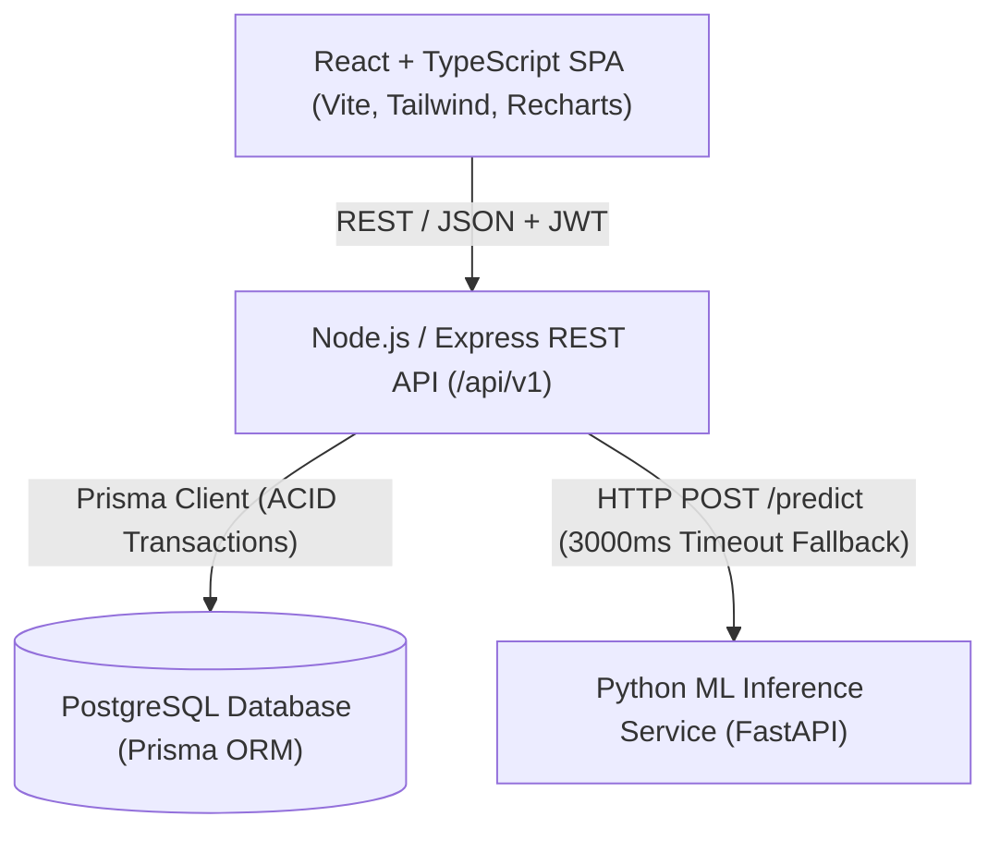

# AI-Powered Hospital OPD Queue and Triage Management System

[](docs/FINAL_REPORT_OUTLINE.md)
[](tsconfig.json)
[](docs/ARCHITECTURE.md)
[](LICENSE)

An intelligent, full-stack hospital Outpatient Department (OPD) queue and clinical triage management platform. The system combines real-time queue orchestration, explainable urgency categorization, anti-starvation dynamic priority scheduling, and machine-learning-driven waiting-time prediction.

---

## 1. Problem Statement & Motivation
Hospital OPDs routinely suffer from extreme congestion, unpredictable patient waiting times, lack of transparent queue progress, and static scheduling that fails to prioritize urgent ambulatory cases. Standard First-Come, First-Served (FCFS) queue policies treat emergency and routine cases identically, while naive priority systems induce starvation of lower-urgency patients.

This project resolves this clinical operational dilemma by integrating:
- **Explainable Clinical Urgency Triage:** 5-tier classification with vital-sign thresholding and doctor override governance.
- **Dynamic Priority Aging Queue:** Mathematical aging formula ($\text{PriorityScore} = W_{\text{tier}} + \alpha \cdot \text{WaitMinutes}$) preventing low-urgency starvation.
- **ML Waiting-Time Prediction:** Supervised regression pipeline (Random Forest) predicting actual consultation start delays.
- **Role-Based Hospital Dashboards:** Dedicated views for Administrators, Receptionists, Doctors, and Patients.
- **Comparative Operational Research:** Reproducible simulation framework benchmarking waiting times and utilization against FCFS.

---

## 2. System Architecture



For complete architectural diagrams and sequence flows, refer to [`docs/ARCHITECTURE.md`](docs/ARCHITECTURE.md).

---

## 3. Technology Stack

- **Frontend:** React 18, TypeScript (Strict), Vite, Tailwind CSS, Lucide React, Recharts.
- **Backend API:** Node.js (v22+), Express.js, TypeScript, Zod (runtime validation), JWT authentication, bcrypt password hashing.
- **Database & ORM:** PostgreSQL, Prisma ORM, versioned SQL migrations.
- **Machine Learning Microservice:** Python 3.10+, FastAPI, NumPy, pandas, scikit-learn (RandomForest, LinearRegression), joblib.
- **Testing:** Vitest, Supertest, React Testing Library, Pytest.
- **Orchestration:** Docker Compose, npm workspaces.

---

## 4. Repository Structure

```text
hospital-opd-management/
├── apps/
│   ├── web/                     # React + TypeScript Frontend Application
│   │   ├── src/
│   │   │   ├── components/      # UI components (cards, badges, modals, forms)
│   │   │   ├── features/        # Role-based pages (Admin, Reception, Doctor, Patient)
│   │   │   ├── hooks/           # Custom React hooks (useAuth, useQueue, usePolling)
│   │   │   └── api/             # Typed API client
│   │   └── tests/               # Frontend component tests
│   └── api/                     # Node.js + Express Backend API
│       ├── src/
│       │   ├── controllers/     # Route handlers
│       │   ├── services/        # Business logic (Queue, Triage, ML Client, Auth)
│       │   ├── middleware/      # Auth, RBAC, error handling, rate limiting
│       │   └── validators/      # Zod validation schemas
│       ├── prisma/              # Schema, migrations, and synthetic seed scripts
│       └── tests/               # API integration tests (Supertest)
├── services/
│   └── ml/                      # Python ML Inference Microservice
│       ├── app/                 # FastAPI application
│       ├── scripts/             # Model training and dataset generation scripts
│       ├── artifacts/           # Versioned model joblib files
│       └── tests/               # Pytest suites
├── research/
│   ├── data/                    # Generated synthetic datasets
│   ├── experiments/             # Simulation benchmark scripts (FCFS vs. Dynamic Aging)
│   └── results/                 # Metrics, tables, and comparative charts
├── docs/                        # Complete technical & academic documentation
├── docker-compose.yml           # Multi-service local container orchestration
├── .env.example                 # Configuration blueprint
└── README.md                    # Project manual
```

---

## 5. Prerequisites & Quick Start

### 5.1 Prerequisites
- Node.js $\ge 18$ (v22 recommended)
- npm $\ge 9$
- Python $\ge 3.10$
- PostgreSQL $\ge 15$

### 5.2 Step 1: Clone & Configure Environment
```bash
cp .env.example .env
```
Ensure database credentials match your PostgreSQL instance.

### 5.3 Step 2: Install Dependencies
```bash
npm install
```

### 5.4 Step 3: Database Migration & Synthetic Seed Data
```bash
npm run db:migrate
npm run db:seed
```

### 5.5 Step 4: Setup Python ML Service
```bash
cd services/ml
python -m venv .venv
# Activate:
# Windows: .venv\Scripts\activate | Linux/macOS: source .venv/bin/activate
pip install -r requirements.txt
python scripts/train_model.py
uvicorn app.main:app --port 8000 --reload
```

### 5.6 Step 5: Start Frontend & Backend
In the project root:
```bash
npm run dev
```
Open [http://localhost:5173](http://localhost:5173) in your browser.

---

## 6. Default Demonstration Accounts

The synthetic seed script generates demonstration accounts for each role (all passwords default to `Password123!` in local development):

| Role | Email Address | Access Scope |
| :--- | :--- | :--- |
| **Administrator** | `admin@opd.org` | System configuration, department stats, audit logs |
| **Receptionist** | `reception@opd.org` | In-person check-in, token issuance, patient lookup |
| **Doctor** | `dr.sharma@opd.org` | Consultation queue, call next, triage override |
| **Patient** | `patient.john@opd.org` | Token status tracking, appointment booking |

---

## 7. Testing & Verification

Execute the automated test suites across all layers:
```bash
# Run API integration and unit tests
npm --prefix apps/api test

# Run frontend UI tests
npm --prefix apps/web test

# Run Python ML pipeline tests
pytest services/ml/tests
```

---

## 8. Documentation Index

- [Project Scope & Boundaries](docs/PROJECT_SCOPE.md)
- [Software Requirements Specification (SRS)](docs/SRS.md)
- [System Architecture & Mermaid Diagrams](docs/ARCHITECTURE.md)
- [Database Schema & ERD](docs/DATABASE.md)
- [REST API Specifications](docs/API.md)
- [Queue Policy & Anti-Starvation Mathematics](docs/QUEUE_POLICY.md)
- [Machine Learning Methodology & Leakage Prevention](docs/ML_METHODOLOGY.md)
- [Security, RBAC & Threat Modeling](docs/SECURITY.md)
- [Testing & Quality Assurance Guide](docs/TESTING.md)
- [Deployment & Docker Guide](docs/DEPLOYMENT.md)
- [Research Plan & Simulation Setup](docs/RESEARCH_PLAN.md)
- [B.Tech CSE Final Thesis Outline](docs/FINAL_REPORT_OUTLINE.md)
- [Viva Voce Defense & Examiner Q&A](docs/VIVA_PREPARATION.md)
- [Architecture Decision Records (ADRs)](docs/DECISIONS.md)
- [Project Progress & Phase Tracking](docs/PROGRESS.md)
- [Changelog](docs/CHANGELOG.md)

---

## 9. Academic Disclaimer
This project is developed as an undergraduate B.Tech Computer Science Engineering research project. The triage scoring and queue prioritization mechanisms are operational decision-support models; they do not perform autonomous medical diagnosis or clinical treatment prescription. All patient data used in demonstrations and tests is 100% synthetically generated.
