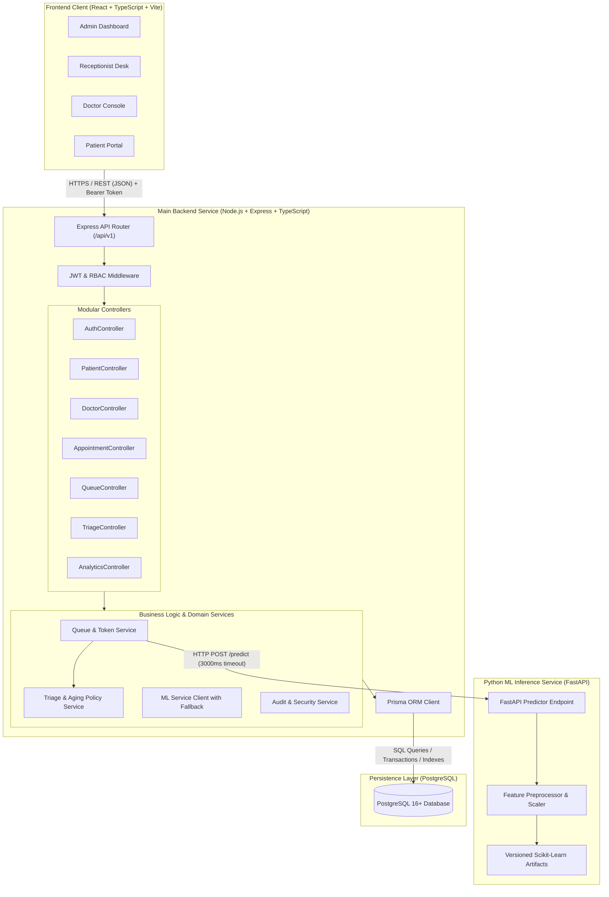
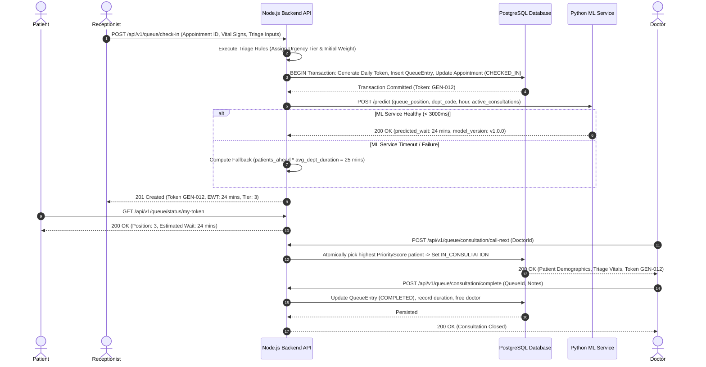

# System Architecture & Technical Design

## 1. Architectural Overview

The AI-Powered Hospital OPD Queue and Triage Management System is architected as a **Modular Monolith** for core clinical/administrative workflows, paired with an isolated **Machine Learning Inference Service** for wait-time predictions.

This pattern provides the ideal trade-off for academic defense and real-world hospital operations:
1. **Low Operational Overhead:** The Node.js Express backend directly coordinates authentication, transactions, queue state, and audit logging in a single cohesive unit without distributed transaction complexity.
2. **Domain-Isolated ML Execution:** Machine learning workloads in Python (NumPy, pandas, scikit-learn) run in a standalone FastAPI service. This isolates compute-intensive model inference from the main transaction loop and prevents memory bloat in Node.js.
3. **Graceful Degradation:** If the Python ML microservice becomes unavailable or slow, the Node.js backend safely falls back to a deterministic rule-based waiting time estimator without disrupting hospital clinical operations.

---

## 2. System Architecture Diagram

---

## 3. Data Flow: Patient Arrival to Consultation Completion

---

## 4. Key Architectural Decisions & Rationale

| Decision | Chosen Solution | Evaluated Alternative | Justification |
| :--- | :--- | :--- | :--- |
| **Monolith vs. Microservices** | Modular Monolith + 1 ML Service | Full Microservices (K8s, Event Bus) | Avoids distributed transaction failures, network latency, and operational overhead while maintaining clean separation of concerns. |
| **Database & ORM** | PostgreSQL + Prisma ORM | MongoDB / Mongoose | Relational integrity, ACID transactions for token counters, foreign key cascades, and compile-time TypeScript type safety. |
| **API Protocol** | RESTful JSON over HTTP | GraphQL or gRPC | Standard HTTP semantics, easy integration testing with Supertest, clean OpenAPI schema generation, and zero overhead for browser clients. |
| **ML Inference Bridge** | REST via Axios with fallback | Direct Python-Node FFI / Kafka | Loosely coupled service boundary; clear network contract; guaranteed non-blocking fallback if Python service fails. |
| **Frontend Framework** | React 18 + TypeScript + Vite | Next.js SSR | Client-side SPA is ideal for dynamic hospital operations dashboards requiring client-side polling and responsive role-based state. |

---

## 5. Security & Boundary Enforcements

1. **No Client Direct Database Access:** The React application communicates solely through `/api/v1` endpoints with validated request payloads.
2. **ML Service Isolation:** The Python service does not connect to PostgreSQL. It receives strictly sanitized feature vectors from the Node.js backend and returns mathematical prediction objects.
3. **Transactional Token Allocation:** Daily queue tokens are scoped by department and calendar day, generated inside serializable/isolated database transactions to guarantee uniqueness even under parallel receptionist check-in actions.
4. **Resilience & Graceful Degradation:** A circuit-breaker / timeout pattern wraps every ML call (default 3000ms). Should the ML service crash or experience latency spikes, the queue workflow continues uninterrupted using calculated fallback estimates clearly flagged to users.
