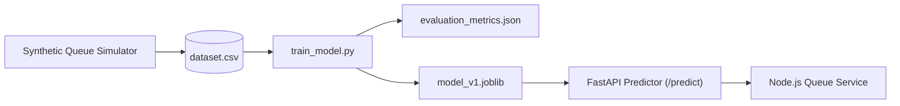

# Machine Learning Methodology: Waiting-Time Prediction Pipeline

## 1. Prediction Objective & Target Definition

The machine learning objective is to predict the **Actual Waiting Time ($Y$) in minutes** from the moment a patient checks in until the doctor begins their consultation:

$$Y_i = \frac{T_{\text{consultation\_start}}(i) - T_{\text{check\_in}}(i)}{60} \quad [\text{minutes}]$$

---

## 2. Prevention of Target Leakage

To ensure academic and practical validity, **zero target leakage** is enforced:
- **Disallowed Features:** Consultation duration of the current patient, total number of patients who arrive after check-in, future doctor breaks, or retrospective completion timestamps.
- **Allowed Features (Strictly Known at Prediction Time):**
  1. `queue_position`: Current 1-based order in the active waiting queue.
  2. `patients_ahead`: Count of waiting patients with higher priority.
  3. `active_consultations_count`: Number of active consultations ongoing across department doctors.
  4. `department_code`: Categorical department identifier (One-Hot Encoded).
  5. `hour_of_day`: Arrival hour (integer: 8 to 18).
  6. `day_of_week`: Day index (integer: 0=Monday to 6=Sunday).
  7. `doctor_experience_years`: Assigned doctor's clinical experience in years.
  8. `urgency_tier`: Assessed urgency tier (integer: 2 to 5).
  9. `historical_avg_duration`: Rolling 30-day average consultation length for the department.

---

## 3. Synthetic Data Generation Methodology

Because real hospital records containing fine-grained timestamp logs are restricted under healthcare privacy laws, we generate a high-fidelity synthetic benchmark dataset modeled after empirically observed queuing systems:

1. **Patient Arrivals:** Modeled as a non-homogeneous Poisson Process (NHPP) with rate $\lambda(t)$ peaking at morning registration hours (08:30 - 11:00) and early afternoon (14:00 - 15:30).
2. **Consultation Times ($S$):** Follow a Log-Normal distribution parameterized by department:
   $$S \sim \text{LogNormal}(\mu_{\text{dept}}, \sigma_{\text{dept}}^2)$$
   - Cardiology: Mean 22 mins ($\sigma = 0.35$)
   - Orthopedics: Mean 16 mins ($\sigma = 0.30$)
   - Pediatrics: Mean 18 mins ($\sigma = 0.40$)
   - General Medicine: Mean 14 mins ($\sigma = 0.25$)
   - Dermatology: Mean 12 mins ($\sigma = 0.20$)
3. **Queue Discipline:** The simulator applies our dynamic aging priority queue policy. Each patient's wait time emerges organically from the queuing simulation without synthetic target shortcuts.
4. **Reproducibility:** A fixed pseudo-random seed (`seed=42`) is set for NumPy, pandas, and scikit-learn.

---

## 4. Benchmark Models & Baseline

### 4.1 Naive Deterministic Baseline
The standard hospital heuristic estimates wait time as:
$$\hat{Y}_{\text{baseline}} = \text{patients\_ahead} \times \bar{D}_{\text{department}}$$
Where $\bar{D}_{\text{department}}$ is the static configured consultation duration for the department.

### 4.2 Candidate Machine Learning Models
1. **Ordinary Least Squares (OLS) / Ridge Regression:** Serves as a transparent linear model benchmark.
2. **Random Forest Regressor (`n_estimators=100`, `max_depth=12`, `random_state=42`):** Captures non-linear queuing delays, interactions between rush hour congestion and doctor experience, and department-specific variance.

---

## 5. Dataset Splitting & Evaluation Metrics

### 5.1 Time-Aware Train/Test Split
To prevent data leakage across temporal sequences, the dataset is split chronologically:
- **Training Set:** First 80% of calendar simulation days.
- **Testing Set:** Held-out remaining 20% of calendar simulation days.

### 5.2 Evaluation Metrics
- **Mean Absolute Error (MAE):** Average magnitude of prediction error in minutes:
  $$\text{MAE} = \frac{1}{N}\sum_{i=1}^N |Y_i - \hat{Y}_i|$$
- **Root Mean Squared Error (RMSE):** Penalizes large wait-time estimation errors:
  $$\text{RMSE} = \sqrt{\frac{1}{N}\sum_{i=1}^N (Y_i - \hat{Y}_i)^2}$$
- **Coefficient of Determination ($R^2$):** Proportion of variance explained by the model.

---

## 6. Model Artifacts & Deployment Pipeline

- Trained models, scalers, and encoders are packaged with `joblib` into `services/ml/artifacts/`.
- The FastAPI service loads model artifacts on startup into memory.
- Health endpoints (`/health`) expose the active model version and inference latency telemetry.
